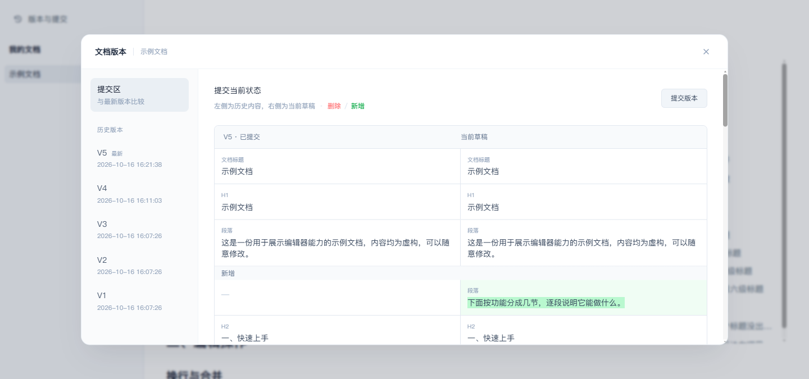

<div align="center">


<h1>idea_doc</h1>

<p><b>内里是一套系统，外面看起来是一份文档。</b></p>

<p><sub>A personal, self-hosted document system — block-based rich-text editing, auto-save and version history.<br />React + TypeScript + Vite + Tailwind CSS · Rust + Axum · MySQL</sub></p>

<p>
  <a href="https://react.dev"></a>
  <a href="https://www.typescriptlang.org"></a>
  <a href="https://vite.dev"></a>
  <a href="https://tailwindcss.com"></a>
  <a href="https://www.rust-lang.org"></a>
  <a href="https://github.com/tokio-rs/axum"></a>
  <a href="https://www.mysql.com"></a>
  <a href="#当前状态"></a>
  <a href="LICENSE"></a>
</p>

<p>
  <a href="#这是一个什么项目">项目定位</a> ·
  <a href="#它能做什么">功能</a> ·
  <a href="#当前状态">当前状态</a> ·
  <a href="#快速开始">快速开始</a> ·
  <a href="#接口一览">接口</a>
</p>

</div>

## 这是一个什么项目

idea_doc 是我**个人自用**的一套文档系统。

它想解决的问题很具体：手上的信息散在好几处——有的来自程序跑出来的结果，有的只是自己随手记下的一句话。分开看每一块都很清楚，合起来却很难看出整体是什么样。

所以这套系统的形态是：**内部是一套系统，对外呈现却是一份文档。**

- 各种「程序」负责把各自那部分数据算出来、存进数据库（这些程序都规划在同一个后端工程里，目前还没有开始写）；
- 数据库里的数据被组织成**一篇篇可以随时编辑的文档**；正文按标题分成一层层章节，将来程序写出来的内容、我随手补的话，都能落到对应的章节里。

一句话概括：**程序负责「算」，文档负责「呈现」。**

文档的好处是能从头读到尾：程序算出来的结果在文中排好，我在旁边写一句说明；程序还没覆盖到的部分，我随手就能补两笔。

使用者只有我一个人，一切都按「一个人用着顺手」来设计。

如果碰巧你也在找这么一个东西——能把程序算出来的数据和自己写的说明放进同一份文档——这个仓库可以直接拿去改：库和表都在 `sql/`，配置都在 `.env`。

<details>
<summary><b>English</b></summary>

**idea_doc** is a personal, self-hosted document system with exactly one user: me.

The idea is to put a document on top of a system. Small programs compute and store their own data in MySQL, and that data gets organized into long-form documents that read top to bottom and stay editable at any time. The programs do the computing, the document does the presenting.

**Features**

- **Multiple documents** — create, rename, delete and drag to reorder; each document keeps its own content
- **Rich text editing** — a block-based rich-text editor, six heading levels, an auto-generated collapsible outline, inline text highlighting in four colors, cross-block selection, rich-text paste from the web, undo and redo
- **Auto-save** — edits sync to the backend every few seconds, and are flushed to MySQL when you switch documents, close the tab, or the backend notices the heartbeat has stopped
- **Version history** — commit the current draft as V1, V2, …; compare the draft against any version in a side-by-side diff (added / deleted / modified / moved blocks, plus inline text and color changes); restore a version back into the draft

**Stack** — React 19 + TypeScript + Vite + Tailwind CSS for the frontend, Rust + Axum + sqlx for the backend, MySQL 8 for storage.

In short: a self-hosted personal document system and note-taking tool, with a block-based rich-text editor, automatic saving and commit-style version history.

</details>

## 它能做什么

**多篇文档**：左侧是文档栏，用来新建、改名、删除，也可以直接拖拽调整顺序。每篇文档的内容相互独立，打开哪篇就编辑哪篇。

**正文编辑**：正文所见即所得，直接在页面上打字就行。标题分 1 ~ 6 级，右侧会自动生成大纲。

- **标题与大纲** — 大纲按标题层级生成，可逐级折叠展开；滚动时高亮当前读到的位置，点一下就能跳过去
- **行内染色** — 一行里可以只给某一小段文字染色（红 / 蓝 / 绿 / 黄），用来标重点；标题不参与染色
- **块级编辑** — 回车在光标处拆出一行，行首退格并入上一行，行尾删除并入下一行，跨行选中与跨行删除同样支持
- **富文本粘贴** — 从网页复制来的标题与彩色文字，粘进来会保留原来的层级与颜色
- **撤销 / 重做** — 标题级别、染色、换行等操作都能撤销，连续打字会合并成一步


**自动保存**：改完就自动存进数据库，右下角有「正在保存 / 已保存 / 保存失败」的提示。切换文档、关闭页面都会把最后的内容落实——即使直接关掉标签页，后端也会在心跳超时后把内容落库，不会丢。

**版本历史**：页面左上角的「版本与提交」里，可以把当前内容提交成一个版本（V1、V2……），也可以拿草稿跟任意一个历史版本左右对照着看红绿 Diff——哪一块被新增、删除、移动，以及文字和颜色的改动，都标得出来。想把某一版重新拿出来改，选中它点「恢复到此版本」即可；恢复只是把内容放回草稿，已经提交的版本链保持不动。日常的自动保存只更新草稿，不会凭空生成版本。



常用快捷键：

| 快捷键 | 作用 |
| --- | --- |
| `Ctrl` + `Alt` + `1` ~ `6` | 把当前行设为对应级别的标题；已在同级标题上再按一次则退回普通文字；选区跨多行时，所有被选中的行统一设为该级别 |
| `Ctrl` + `Alt` + `R` / `B` / `G` / `Y` | 把选中文字染成红 / 蓝 / 绿 / 黄 |
| `Ctrl` + `Z` / `Ctrl` + `Shift` + `Z` | 撤销 / 重做 |
| `Enter` | 在光标处拆成新的一行 |
| `Backspace` / `Delete` | 行首退格并入上一行 / 行尾删除并入下一行 |

## 当前状态

项目还在早期，但**文档这一层已经可以真正用起来了**：多篇文档、正文编辑、自动保存、版本历史、数据落库都已经打通，建好库打开页面就能写。

| 状态 | 内容 |
| --- | --- |
| ✅ | 多篇文档：新建、改名、删除（逻辑删除，内容仍保留）、拖拽排序 |
| ✅ | 正文编辑与呈现：标题与大纲、行内染色、撤销重做、富文本粘贴 |
| ✅ | 自动保存：编辑期定时同步，切换文档 / 关闭页面立即落库，服务退出前兜底 |
| ✅ | 版本历史：提交 V1 / V2…、与任意历史版本做红绿 Diff、把历史版本恢复为草稿 |
| ✅ | 数据落库：文档与正文块存进 MySQL，正文已按标题层级分好章节；建表与示例数据脚本在 `sql/` |
| 🚧 | 「程序」层：正在规划，文档内容目前由我手写维护 |
| 🚧 | 更多块类型：图片、代码块、表格等会陆续加进来 |

README 会随着代码的提交逐步补充，这里描述的只是当下的样子。

## 技术构成

| 部分 | 选型 |
| --- | --- |
| 前端 | React 19 + TypeScript + Vite + Tailwind CSS v4（包管理用 pnpm） |
| 后端 | Rust + Axum + sqlx（tokio 运行时） |
| 数据库 | MySQL 8（`utf8mb4`） |
| 编辑器 | 在浏览器原生 `contenteditable` 上自研的块级编辑器 |

前后端分离。开发期由 Vite 把 `/api` 开头的请求反向代理到后端，只跑一个前端进程也能直接联调。

整个仓库也能当成两份可以直接读的样例代码：Rust + Axum + sqlx 的完整 CRUD 与增量落库在 `backend/src/`，基于 `contenteditable` 的块级编辑器在 `frontend/src/components/`。

## 目录结构

```
idea_doc/
├── docs/images/   # README 引用的截图
├── sql/           # 建表脚本与示例数据
├── frontend/      # 前端：React + TypeScript + Vite + Tailwind CSS
└── backend/       # 后端：Rust + Axum，接口与后续的「程序」都放在这里
```

## 环境要求

| 依赖 | 版本 |
| --- | --- |
| Node.js | 20 及以上 |
| pnpm | 10 及以上 |
| Rust | 1.85 及以上（edition 2024） |
| MySQL | 8.0 及以上 |

## 快速开始

### 1. 建库并导入脚本

```bash
mysql -u root -p < sql/01_schema.sql
mysql -u root -p < sql/02_sample_data.sql   # 可选：导入一份示例文档
```

脚本会创建 `idea_doc` 库和所需的表，字符集为 `utf8mb4`，完整支持中文与 emoji。版本历史用到的字段与两张历史表也在同一个脚本里；已有的库重复执行一遍就会自动补齐，老文档的版本从你第一次点「提交版本」时开始记。

### 2. 启动后端

```bash
cd backend
cp .env.example .env   # 把 DATABASE_URL 改成自己的账号密码
cargo run
```

服务默认监听 `http://127.0.0.1:3000`，其余可配置项见 `backend/.env.example`。

### 3. 启动前端

```bash
cd frontend
pnpm install
pnpm dev
```

前端启动后会自动打开浏览器进入 `http://localhost:5173`。文档列表与内容都来自数据库，所以需要后端已经跑起来。

## 接口一览

| 方法 | 路径 | 说明 |
| --- | --- | --- |
| GET | `/api/health` | 服务与数据库的健康状态 |
| GET | `/api/db/ping` | 数据库连通性探测 |
| GET | `/api/documents` | 文档列表 |
| POST | `/api/documents` | 新建文档 |
| PUT | `/api/documents/order` | 按提交的顺序重排文档 |
| GET | `/api/documents/{id}` | 读取单篇文档（含全部内容块） |
| PATCH | `/api/documents/{id}` | 修改文档标题 |
| DELETE | `/api/documents/{id}` | 逻辑删除文档 |
| PUT | `/api/documents/{id}/snapshot` | 推送全文快照，可要求立即落库 |
| POST | `/api/documents/{id}/heartbeat` | 编辑期心跳，超时后由后端落库 |
| POST | `/api/documents/{id}/versions` | 把当前标题与全部内容提交为一个新版本 |
| GET | `/api/documents/{id}/versions` | 版本链，倒序返回，`before` 为翻页游标 |
| GET | `/api/documents/{id}/versions/{version}` | 读取指定历史版本的标题与正文 |
| POST | `/api/documents/{id}/versions/{version}/diff` | 比较请求中的内容与指定版本 |
| POST | `/api/documents/{id}/versions/{version}/restore` | 把指定历史版本恢复为当前草稿 |

所有接口统一返回 `{ code, message, data }`，`code` 为 `0` 表示成功。

> 保存是自动的：编辑期间的内容先同步到后端，切换文档或离开页面时才真正写进数据库。

提交与 Diff 都以 `{ title, blocks }` 为请求体。恢复只把历史版本放回草稿，版本链上已经记下的版本保持不动。

## License

[MIT](LICENSE) © 2026 luxongray
